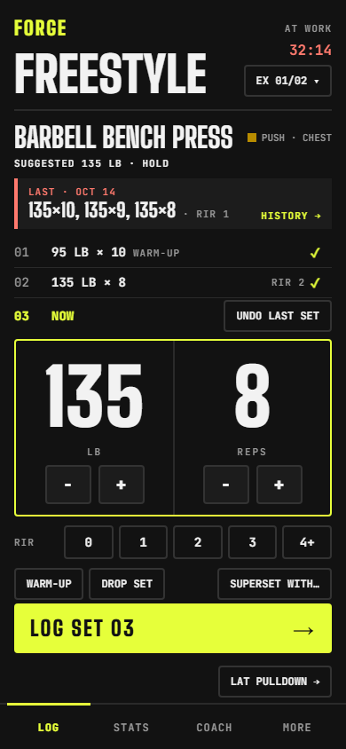
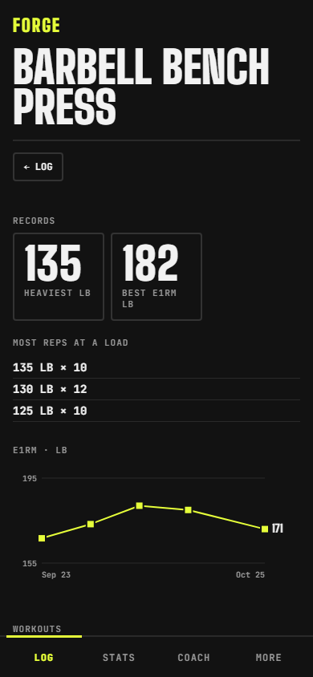
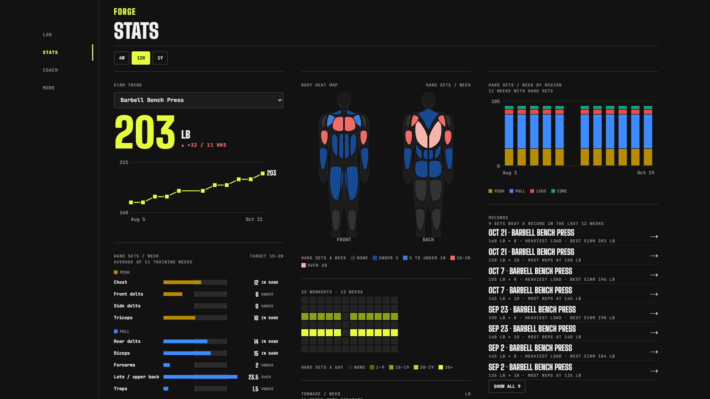

# Forge

A workout tracker I built to log my own workouts: log sets on the phone at the gym, then see progress on a dashboard on any screen. It's a solo project run like a professional software project, with specs, tickets, triage, test-first development, code review and CI.

  
  

Screenshots use made-up data.

## What it does

- **Logging, phone first.** A set takes one tap: each set fills in from the last one, with steppers to adjust. The screen shows the last workout's sets and a suggested weight from double progression. It also has a rest timer, supersets, swapping an exercise for one this gym has, records, undo, and logging with no signal.
- **Dashboard.** Estimated one-rep-max trends, hard sets per muscle group against a target band, a body heat map, a calendar of workouts, tonnage and a record timeline. Phone and wide-screen layouts.
- **Library and routines.** About 150 exercises tagged across 17 muscle groups, custom exercises, versioned routines, and gyms defined by the exercises they have.
- **Your data is yours.** Export everything as JSON or CSV.
- **AI coach (next).** A weekly review that proposes routine changes. Everything else works without AI.

## How it's built

**Stack.** An installable web app in plain HTML, CSS and JavaScript modules with no build step: the files in the repo are the files served. Data lives in Firebase Firestore behind Google sign-in, and GitHub Pages hosts the app. Development tooling: Vitest, ESLint, Prettier, TypeScript checking JSDoc types, the Firebase emulators, and Playwright for screenshots.

**Architecture.** The domain logic in `app/js/core/` has no DOM and no database code. It talks to storage through a small `Store` port with two implementations, in-memory and Firestore, and the same contract tests run against both. Screens only render what the core returns.

**Process.** I'm the product owner and maintainer. Claude Code, Anthropic's AI coding agent, writes most of the code. The process is what keeps that reliable:

1. **Spec.** A design interview produced [`DESIGN.md`](DESIGN.md) and a [`GLOSSARY.md`](GLOSSARY.md) of domain terms. Each phase starts as a spec issue with user stories ([#3](https://github.com/jvadgama1/forge/issues/3), [#80](https://github.com/jvadgama1/forge/issues/80)).
2. **Tickets.** Each spec is split into thin, end-to-end GitHub issues with acceptance criteria.
3. **Triage.** Every issue, including feedback from using the app, moves through labelled states: `needs-triage`, `needs-info`, `ready-for-agent`, `ready-for-human`, `wontfix`.
4. **Build.** One short-lived branch per issue, test-first (red, green, refactor).
5. **Review.** Every change is reviewed on two axes: does it follow [`CODING_STANDARDS.md`](CODING_STANDARDS.md), and does it do what the issue asked? Findings are fixed or answered before merge.
6. **Pull request.** Each one carries evidence (test results, before and after screenshots), how risky it is to merge, and `Closes #n`. CI must pass, then it's squash-merged into a protected `main`, which deploys.
7. **Decisions.** Trade-offs are recorded as [ADRs](docs/adr/). Choices that are easy to undo and visible in use are made and noted in the pull request. Security, privacy and data changes wait for my approval.

The working agreement is in [`CLAUDE.md`](CLAUDE.md).

**Quality gates.** A pre-commit hook formats, lints, type-checks and tests. CI runs the full check on every pull request and is required on `main`. There are over 300 unit tests, plus emulator tests for the Firestore store and the security rules.

**Privacy.** The repo is public, but no personal data is in it ([ADR-0005](docs/adr/0005-public-repo-no-personal-data.md)). The Firebase web config in `app/js/` is public by design: Firestore security rules, tested against the emulator, restrict all data to one account.

## Status

Logging my own workouts since late October 2026.

- **Phase 1, logging:** done.
- **Phase 2, dashboard:** done.
- **Phase 3, AI coach:** next.
- **Now:** working through feedback from real use ([open issues](https://github.com/jvadgama1/forge/issues)).
